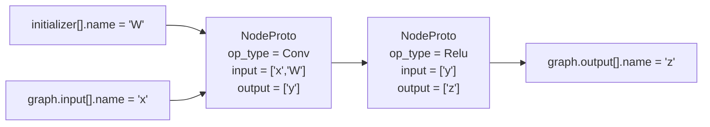

# ONNX Graph 结构完整描述（自包含、逐层展开）

> 依据：`onnx` 1.14.1 的 `onnx.proto` 实际 descriptor（字段名、字段号、类型、label 全部从 `onnx_pb` 反查，非手写记忆）。

## 阅读约定

- `字段名 : 类型` —— 冒号右边就是这个字段的 proto 类型。
- `[]` —— `repeated`（列表）。
- `enum X` —— 枚举类型（底层 int32）。
- 凡是引用到别的复合类型，**第一次出现的地方直接就地展开**，能看到它的全部字段；
  递归引用（`GraphProto` 里套 `GraphProto`）才用 `→ 见上/见下` 指路。

## 类型索引（哪个类型在哪里展开）

- `ModelProto` → §1 树顶
- `GraphProto` → §1 树中 `graph`
- `NodeProto` → §1 `graph.node[]`
- `ValueInfoProto` → §1 `graph.input[]`
- `TypeProto`（及 6 个子类型）→ §1 `graph.input[].type`
- `AttributeProto` → §1 `graph.node[].attribute[]`
- `TensorProto` → §1 `graph.initializer[]`
- `SparseTensorProto` → §1 `graph.sparse_initializer[]`
- `OperatorSetIdProto` / `StringStringEntryProto` / `TensorAnnotation` / `FunctionProto` / `TrainingInfoProto` → 均在 §1 对应位置就地展开
- 枚举取值 → §3

---

## 1. 完整类型树（每个字段都标类型，复合类型就地展开）

```
ModelProto                                              # 一个 .onnx 文件 = 一个 ModelProto
│
├── ir_version : int64                                  # (1)  ONNX IR 版本
├── opset_import[] : OperatorSetIdProto                 # (8)  repeated，算子集版本
│   ├── domain : string                                 #      (1) "" 表示默认域 ai.onnx
│   └── version : int64                                 #      (2) 如 13 / 17
├── producer_name : string                              # (2)  导出工具，如 "pytorch"
├── producer_version : string                           # (3)
├── domain : string                                     # (4)
├── model_version : int64                               # (5)
├── doc_string : string                                 # (6)
├── graph : GraphProto                                  # (7)  ★★★ 计算图主体（单数，只有一个）
│   │
│   ├── node[] : NodeProto                              # (1)  ★★★ repeated，算子实例
│   │   ├── input[] : string                            #   (1) ★ 只是张量“名字”，不是张量对象！
│   │   ├── output[] : string                           #   (2) ★ 只是张量“名字”
│   │   ├── name : string                               #   (3) 节点名，常为空
│   │   ├── op_type : string                            #   (4) ★ 算子类型 "Conv"/"MatMul"/"Relu"...
│   │   ├── attribute[] : AttributeProto                #   (5) 算子属性，展开见下 ↓
│   │   │   ├── name : string                           #      (1) 如 "kernel_shape" / "strides"
│   │   │   ├── ref_attr_name : string                  #      (21) 仅 FunctionProto 内引用用
│   │   │   ├── doc_string : string                     #      (13)
│   │   │   ├── type : enum AttributeProto.AttributeType #     (20) ★ 判别式：决定下面哪个值字段有效
│   │   │   ├── ── 标量值（与 type 一一对应）──
│   │   │   ├── f : float                               #      (2)  type = FLOAT  (1)
│   │   │   ├── i : int64                               #      (3)  type = INT    (2)
│   │   │   ├── s : bytes                               #      (4)  type = STRING (3)
│   │   │   ├── ── 复合值 ──
│   │   │   ├── t : TensorProto                         #      (5)  type = TENSOR (4)        → 见 initializer[] 的展开
│   │   │   ├── g : GraphProto                          #      (6)  type = GRAPH  (5)        → 递归子图，见本页 graph 展开
│   │   │   ├── sparse_tensor : SparseTensorProto       #      (22) type = SPARSE_TENSOR (11) → 见 sparse_initializer[] 的展开
│   │   │   ├── tp : TypeProto                          #      (14) type = TYPE_PROTO (13)   → 见 input[].type 的展开
│   │   │   ├── ── 列表值（注意与上面标量字段是不同字段！）──
│   │   │   ├── floats[] : float                        #      (7)  type = FLOATS  (6)
│   │   │   ├── ints[] : int64                          #      (8)  type = INTS    (7)  ← "strides"/"pads" 常用
│   │   │   ├── strings[] : bytes                       #      (9)  type = STRINGS (8)
│   │   │   ├── tensors[] : TensorProto                 #      (10) type = TENSORS (9)
│   │   │   ├── graphs[] : GraphProto                   #      (11) type = GRAPHS  (10)
│   │   │   ├── sparse_tensors[] : SparseTensorProto    #      (23) type = SPARSE_TENSORS (12)
│   │   │   └── type_protos[] : TypeProto               #      (15) type = TYPE_PROTOS   (14)
│   │   ├── doc_string : string                         #   (6)
│   │   └── domain : string                             #   (7) "" = ai.onnx；自定义算子如 "com.microsoft"
│   │
│   ├── name : string                                   # (2)  图名
│   │
│   ├── initializer[] : TensorProto                     # (5)  ★★★ repeated，常量权重
│   │   ├── dims[] : int64                              #   (1) ★ shape（是 repeated int64，不是 TensorShapeProto！）
│   │   ├── data_type : enum TensorProto.DataType       #   (2) ★ 元素类型，见 §3 枚举
│   │   ├── segment : TensorProto.Segment               #   (3) 已废弃，忽略
│   │   │   ├── begin : int64                           #      (1)
│   │   │   └── end : int64                             #      (2)
│   │   ├── ── 数据体（下面这些语义上多选一，通常只用 raw_data）──
│   │   ├── float_data[] : float                        #   (4)
│   │   ├── int32_data[] : int32                        #   (5)  也承载 int8/uint8/int16/bool/float16
│   │   ├── string_data[] : bytes                       #   (6)
│   │   ├── int64_data[] : int64                        #   (7)
│   │   ├── name : string                               #   (8) ★ 张量名，被 node.input[] 按名字引用
│   │   ├── raw_data : bytes                            #   (9) ★ 最常见：小端序紧凑字节流
│   │   ├── double_data[] : double                      #   (10)
│   │   ├── uint64_data[] : uint64                      #   (11)
│   │   ├── doc_string : string                         #   (12)
│   │   ├── external_data[] : StringStringEntryProto    #   (13) 大模型权重外置成独立文件时用
│   │   │   ├── key : string                            #        "location"/"offset"/"length"/"checksum"
│   │   │   └── value : string
│   │   └── data_location : enum TensorProto.DataLocation  # (14) DEFAULT=0(内嵌) / EXTERNAL=1(外置)
│   │
│   ├── sparse_initializer[] : SparseTensorProto        # (15) 稀疏权重（很少用）
│   │   ├── values : TensorProto                        #   (1) → 见上面 initializer[] 的 TensorProto 展开
│   │   ├── indices : TensorProto                       #   (2) → 同上
│   │   └── dims[] : int64                              #   (3)
│   │
│   ├── doc_string : string                             # (10)
│   │
│   ├── input[] : ValueInfoProto                        # (11) ★★★ repeated，图的输入
│   │   ├── name : string                               #   (1) 被 node.input[] 按名字引用
│   │   ├── type : TypeProto                            #   (2) ★ 展开见下 ↓
│   │   │   ├── tensor_type : TypeProto.Tensor          #      (1) oneof：下面 6 个最多只有 1 个被设置
│   │   │   │   ├── elem_type : enum TensorProto.DataType  #   (1) FLOAT=1 / INT8=3 / FLOAT16=10 ...
│   │   │   │   └── shape : TensorShapeProto            #      (2)
│   │   │   │       └── dim[] : TensorShapeProto.Dimension  # (1) oneof：要么具体值，要么符号名
│   │   │   │           ├── dim_value : int64           #         (1) 静态维度，如 1 / 3 / 224
│   │   │   │           ├── dim_param : string          #         (2) 动态维度符号 "batch_size" / "N"
│   │   │   │           └── denotation : string         #         (3)
│   │   │   ├── sequence_type : TypeProto.Sequence      #      (4) 变长序列
│   │   │   │   └── elem_type : TypeProto               #         (1) ★ 递归，元素又是任意 TypeProto
│   │   │   ├── map_type : TypeProto.Map                #      (5) 字典
│   │   │   │   ├── key_type : enum TensorProto.DataType #        (1)
│   │   │   │   └── value_type : TypeProto              #         (2) ★ 递归
│   │   │   ├── optional_type : TypeProto.Optional      #      (9)
│   │   │   │   └── elem_type : TypeProto               #         (1) ★ 递归
│   │   │   ├── sparse_tensor_type : TypeProto.SparseTensor  # (8)
│   │   │   │   ├── elem_type : enum TensorProto.DataType #       (1)
│   │   │   │   └── shape : TensorShapeProto            #         (2)
│   │   │   ├── opaque_type : TypeProto.Opaque          #      (7) 自定义不透明类型
│   │   │   └── denotation : string                     #      (6) 语义标注，一般不用
│   │   └── doc_string : string                         #   (3)
│   │
│   ├── output[] : ValueInfoProto                       # (12) ★★★ repeated，图的输出
│   │   └── ... 结构与 input[] 完全相同（name / type : TypeProto / doc_string）
│   │
│   ├── value_info[] : ValueInfoProto                   # (13) 中间张量的类型/shape（★ 经常为空！见 §4）
│   │   └── ... 结构与 input[] 完全相同
│   │
│   └── quantization_annotation[] : TensorAnnotation    # (14) 量化标注
│       ├── tensor_name : string                        #   (1)
│       └── quant_parameter_tensor_names[] : StringStringEntryProto  # (2)
│           ├── key : string                            #        如 "SCALE_TENSOR" / "ZERO_POINT_TENSOR"
│           └── value : string                          #        对应张量名
│
├── metadata_props[] : StringStringEntryProto           # (14) repeated
│   ├── key : string
│   └── value : string
│
├── training_info[] : TrainingInfoProto                 # (20) repeated，推理模型为空
│   ├── initialization : GraphProto                     #   (1) → 递归，见本页 graph 的展开
│   ├── algorithm : GraphProto                          #   (2) → 递归，见本页 graph 的展开
│   ├── initialization_binding[] : StringStringEntryProto  # (3)
│   └── update_binding[] : StringStringEntryProto       #   (4)
│
└── functions[] : FunctionProto                         # (25) repeated，自定义函数（可内联展开成 node）
    ├── name : string                                   #   (1)
    ├── input[] : string                                #   (4)
    ├── output[] : string                               #   (5)
    ├── attribute[] : string                            #   (6) 注意：这里是 string 列表，不是 AttributeProto
    ├── attribute_proto[] : AttributeProto              #   (11) → 见 node[].attribute[] 的展开
    ├── node[] : NodeProto                              #   (7)  → 见 node[] 的展开
    ├── doc_string : string                             #   (8)
    ├── opset_import[] : OperatorSetIdProto             #   (9)
    └── domain : string                                 #   (10)
```

---

## 2. 图的“边”是隐式的（最容易被误解的一点）

ONNX 文件里**没有独立的 edge 对象**。连线规则就是字符串相等：

> `NodeProto.input[k]` 的值 == 某个 `NodeProto.output[j]` 的值，或者 == 某个 `GraphProto.input[].name` / `initializer[].name`



所以写解析器时，一般先建一张 `name -> ValueInfoProto`（或 `name -> TensorProto`）的字典，再去解析每个 node。

---

## 3. 枚举取值

`TensorProto.DataType`（`TypeProto.Tensor.elem_type`、`TensorProto.data_type` 用）：

```
UNDEFINED=0  FLOAT=1  UINT8=2  INT8=3  UINT16=4  INT16=5  INT32=6  INT64=7
STRING=8  BOOL=9  FLOAT16=10  DOUBLE=11  UINT32=12  UINT64=13
COMPLEX64=14  COMPLEX128=15  BFLOAT16=16
FLOAT8E4M3FN=17  FLOAT8E4M3FNUZ=18  FLOAT8E5M2=19  FLOAT8E5M2FNUZ=20
```

`AttributeProto.AttributeType`（`AttributeProto.type` 用）：

```
UNDEFINED=0  FLOAT=1  INT=2  STRING=3  TENSOR=4  GRAPH=5  FLOATS=6  INTS=7
STRINGS=8  TENSORS=9  GRAPHS=10  SPARSE_TENSOR=11  SPARSE_TENSORS=12
TYPE_PROTO=13  TYPE_PROTOS=14
```

`TensorProto.DataLocation`（`TensorProto.data_location` 用）：

```
DEFAULT=0   # 数据内嵌在 raw_data / *_data 字段
EXTERNAL=1  # 数据在外部文件，看 external_data[]
```

---

## 4. 踩坑清单

1. **`node.input/output` 是名字，不是张量。** 拿 shape/dtype 要用名字去 `input` / `output` / `value_info` / `initializer` 里查。
2. **`value_info[]` 可以为空。** 很多导出器（含部分 PyTorch 导出）不填中间张量信息，此时中间 shape 要靠 shape inference 推：
   ```python
   from onnx import shape_inference
   inferred = shape_inference.infer_shapes(model)
   ```

   这也是中间张量 shape 显示成 `dim_param`（符号名）而不是数字的常见原因。
3. **`initializer` 同时算“常量”和“图输入”。** IR < 4 时 initializer 也会出现在 `graph.input` 里；IR ≥ 4 后不再重复。要拿真正的“外部输入”，用 `graph.input - {initializer names}`。
4. **`dim_value` / `dim_param` 是 oneof。** 动态 batch 时是 `dim_param="batch_size"`，静态时才是 `dim_value=N`。
5. **算子语义由 `opset_import` 决定。** 同一个 `op_type` 在不同 opset 下属性/输入个数可能不同，解析属性前先看 `model.opset_import`。
6. **子图藏在 attribute 里。** `If` / `Loop` / `Scan` 的循环体是 `AttributeProto.g`（`GraphProto`），不是顶层 `graph.node`，递归遍历时要单独处理。
7. **`AttributeProto` 的值字段必须与 `type` 对应。** 只看 `type` 判断读 `i` 还是 `ints`，不要靠“哪个非空”猜。
8. **`FunctionProto.attribute[]` 是 `string` 列表**，而 `NodeProto.attribute[]` 是 `AttributeProto` 列表，两者同名但类型不同，别搞混。

---

## 5. 一句话总览（背诵版）

```
ModelProto
 └─ graph : GraphProto
     ├─ node[]      : NodeProto      { op_type, domain, input[]:string, output[]:string, attribute[]:AttributeProto }
     ├─ input[]     : ValueInfoProto { name, type:TypeProto }   # 同理 output[] / value_info[]
     │                    TypeProto.tensor_type{ elem_type:DataType, shape:TensorShapeProto.dim[] }
     └─ initializer[] : TensorProto  { name, dims[], data_type, raw_data|typed_data|external_data }
```

- 图 = `NodeProto` 列表 + 名字索引表
- 边 = 字符串名字相等（隐式）
- 类型信息 = `ValueInfoProto → TypeProto → tensor_type{ elem_type, shape }`
- 权重 = `TensorProto`（在 `initializer`）
- 算子参数 = `AttributeProto`（`type` 判别 + 对应值字段）
